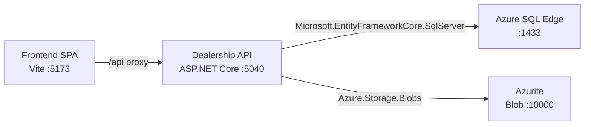

# Azure Debug Plan

> This plan is the source of truth for generating the
> VS Code debug setup in this workspace.
>
> **Status:** Implemented
> **Execution Mode:** Guided
> **Created:** 2026-10-09T14:46:25Z
> **Last Updated:** 2026-10-09T14:59:00Z
>
> <!-- Guided Mode (default) - hand-holds the user through review and approval before generating. -->

---

## Prerequisites

| Tool / Extension | Category | Service(s) | Installed | Version |
|------------------|----------|------------|-----------|---------|
| Node.js | Runtime | frontend | ✅ | v24.15.0 |
| npm | Package manager | frontend | ✅ | 11.12.1 |
| .NET SDK | Runtime / SDK | dealership-api | ✅ | 9.0.318 |
| Docker | Container runtime | dealership-api | ✅ | 29.2.0 (Docker Desktop; engine ready) |
| Docker Compose | Compose provider | dealership-api | ✅ | v5.0.2 |
| Chrome | Browser | frontend | ✅ | 154.0.8037.98 |
| ms-dotnettools.csdevkit | VS Code extension | dealership-api | ❓ | — |
| ms-azuretools.vscode-docker | VS Code extension | dealership-api, frontend | ✅ | 2.0.0 |

> ⚠️ **Action required:** Confirm `ms-dotnettools.csdevkit` is installed and ready before approving this plan.

---

## Debug Configurations

Each checked service produces a VS Code debug configuration in `.vscode/launch.json`.

| Generate | Debug Config Name | Service Label | Service Root | Project Type | Runtime | Version | Azure Dependencies |
|----------|--------------------|---------------|--------------|--------------|---------|---------|---------------------|
| [x] | Dealership API (debug) | Dealership API | ./backend/Dealership.Api | app-service | dotnet | 9.0 | Azure SQL, Blob Storage |
| [x] | Frontend (debug) | Frontend | ./frontend | frontend-spa | node-ts | 24.15.0 | — |
| [x] | Debug All Services | Debug All Services | — | *Compound Config* | — | — | — |

Project Type Descriptions

| Project Type | Description |
|-------------|-------------|
| app-service | ASP.NET Core HTTP API launched with the .NET SDK. |
| frontend-spa | Vite single-page application launched in a browser. |

> ℹ️ **Proxy detected:** Frontend proxies `/api` to the Dealership API at `http://localhost:5040` in `frontend/vite.config.ts`. The compound configuration should start the API before the frontend.

---

## Orchestrator

| Orchestrator | Container Runtime | Compose Command | Description |
|-------------|-------------------|-----------------|-------------|
| Docker Compose | Docker | `docker compose` | Docker Desktop is running. Reuse the existing root `docker-compose.yml`; it already defines SQL Edge and Azurite. |

---

## Emulators

| Dependent Service | Emulator | Purpose |
|-------------------|----------|---------|
| Azure SQL | Azure SQL Edge container | Local SQL Server-compatible database for Entity Framework Core. |
| Blob Storage | Azurite container | Local Blob Storage for vehicle photo uploads. |

---

## Architecture Diagram

During local debugging, the Vite frontend proxies API requests to the ASP.NET Core API, which connects to SQL Edge and Azurite containers.

---

## Migrations

When selected, the generation phase creates an automated VS Code task to apply the existing migrations before API debugging.

| Generate | Service | Migration Tool |
|----------|---------|----------------|
| [x] | Dealership API | EF Core |

---

## API Test Collections

When selected, the generation phase creates runnable HTTP smoke tests for the API.

| Generate | Service | Description |
|----------|---------|-------------|
| [x] | Dealership API | 

HTTP Endpoints (7)
 GET /api/health GET /api/vehicles GET /api/vehicles/{id} POST /api/vehicles PUT /api/vehicles/{id} DELETE /api/vehicles/{id} POST /api/upload
 |

---

## Convenience Scripts

| Generate | Script | Registered In | Description |
|----------|--------|---------------|-------------|
| [x] | emulators:start | ./package.json | Start SQL Edge and Azurite using the existing Compose file. |
| [x] | emulators:stop | ./package.json | Stop local emulator containers while retaining container data. |
| [ ] | emulators:clean | ./package.json | Remove local emulator containers and data; left unchecked because cleanup is destructive. |
| [x] | db:migrate | ./package.json | Apply the existing EF Core migrations to the local SQL Edge database. |

## Debug Configuration Checklist

- ✅ Dealership API (debug) — ready signal observed: `Now listening on: http://localhost:5040`; HTTP verification passed with `curl` returning `200` from `http://localhost:5040/api/health`.
- ✅ Frontend (debug) — ready signal observed: `VITE v8.3.4` and `Local: http://localhost:5173/`; HTTP verification passed with `curl` returning `200` from `http://localhost:5173`.
- ✅ Debug All Services — sequenced compound startup succeeded with backend first, frontend second, and both reached their ready signals plus HTTP checks at the expected ports.